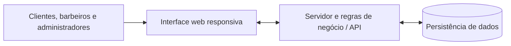

# Sistema de Gestão e Agendamento para Barbearias

**Projeto Integrador IV | Tecnologia em Análise e Desenvolvimento de Sistemas | Senac EAD | 2026**

> **Status:** projeto acadêmico em desenvolvimento. A primeira entrega definiu a visão conceitual do produto; as funcionalidades descritas neste README representam o escopo previsto, não uma aplicação já concluída.

## Sobre o projeto

O projeto propõe uma **aplicação web responsiva** para facilitar o agendamento de serviços de barbearia e a organização das agendas dos profissionais. A plataforma será acessível pelo navegador de celulares, tablets e computadores, contemplando três perfis principais: **cliente, barbeiro e administrador/proprietário**.

A proposta surgiu da identificação de dificuldades no agendamento tradicional por telefone ou mensagens: demora nas respostas, interrupções durante os atendimentos, pouca visibilidade dos horários disponíveis e risco de reservas conflitantes.

A solução busca oferecer autonomia ao cliente e maior controle operacional à barbearia.

## Objetivos

- **Clientes:** consultar serviços, profissionais e horários disponíveis e solicitar agendamentos com praticidade.
- **Barbeiros:** visualizar seus compromissos e acompanhar os atendimentos agendados.
- **Administradores:** organizar informações da barbearia, serviços, profissionais e agenda de atendimentos.
- **Equipe acadêmica:** aplicar conhecimentos de desenvolvimento web, linguagens de servidor, arquitetura de software e gerenciamento de projetos em um protótipo funcional.

## Funcionalidades previstas

| Módulo | Funcionalidades planejadas |
| --- | --- |
| Contas e perfis | Cadastro, autenticação e controle de acesso conforme o perfil do usuário. |
| Catálogo | Consulta de barbearias, profissionais e serviços, incluindo preço e duração. |
| Disponibilidade | Visualização de datas e horários disponíveis para cada profissional. |
| Agendamentos | Seleção de serviço, profissional, data e horário; confirmação e acompanhamento da reserva. |
| Agenda profissional | Consulta de atendimentos do dia e da semana, com respectivos status. |
| Histórico | Consulta de agendamentos anteriores e de atendimentos realizados, conforme permissões. |

**Delimitação do MVP em discussão:** há uma proposta de começar por **uma barbearia** e deixar a operação multiestabelecimento, os pagamentos eletrônicos e relatórios avançados para evoluções posteriores. Essa redução de escopo ainda precisa ser validada pelo grupo e, quando necessário, pelo professor orientador. A primeira entrega conceitual contempla um catálogo de barbearias e menciona uma etapa de pagamento na jornada do usuário.

## Perfis de acesso

| Perfil | Necessidade principal |
| --- | --- |
| Cliente | Localizar um serviço e reservar um horário sem depender de contato manual. |
| Barbeiro | Consultar a agenda de trabalho e preparar os atendimentos. |
| Administrador/proprietário | Gerenciar a operação e acompanhar os agendamentos do estabelecimento. |

A primeira entrega também documenta duas personas para orientar o desenvolvimento: **Lucas Pereira Ramos** (cliente) e **Carlos Felipino da Silva** (proprietário de barbearia).

## Jornada principal do usuário

1. O cliente acessa a plataforma pelo navegador.
2. Consulta a barbearia, os serviços e os profissionais disponíveis.
3. Seleciona o serviço, a data e um horário livre.
4. Confirma a solicitação de agendamento.
5. Consulta o agendamento e seu status na área de acompanhamento.

A implementação deverá validar conflitos de agenda antes de confirmar reservas. O tratamento de pagamentos permanece sujeito à definição do escopo do MVP.

## Arquitetura e tecnologias

A organização técnica abaixo é uma **proposta de referência**, ainda não uma descrição de componentes implementados.



| Camada | Direção proposta | Situação |
| --- | --- | --- |
| Interface | HTML, CSS e JavaScript, com layout responsivo | A confirmar pela equipe |
| Servidor | API e regras de negócio; PHP é uma das opções avaliadas | A definir |
| Persistência | Banco de dados relacional; MySQL é uma das opções avaliadas | A definir |
| Infraestrutura | Ambiente de execução, hospedagem e estratégia de publicação | A definir |

As escolhas definitivas deverão ser registradas após alinhamento técnico do grupo. O README será atualizado com os requisitos, comandos de instalação e execução conforme o código for desenvolvido.

## Organização sugerida do repositório

A estrutura abaixo é uma **sugestão**, não uma afirmação de que as pastas já existem:

```text
barbearia-app/
├── frontend/             # Páginas, estilos e scripts da interface
├── backend/              # Serviços e regras de negócio
├── database/             # Modelo de dados e scripts do banco
├── docs/                 # Requisitos, diagramas e documentação técnica
├── tests/                # Testes e evidências de validação
└── README.md             # Visão geral e orientação de colaboração
```

> O Git não rastreia diretórios vazios. Se for necessário preparar a estrutura antes dos arquivos reais, crie um `.gitkeep` nas pastas vazias.

## Como colaborar

O repositório do grupo é [**isabellyfranklin/barbearia-app**](https://github.com/isabellyfranklin/barbearia-app). Sua branch principal atual é `master`.

**1. Clonar o repositório:**

```bash
git clone https://github.com/isabellyfranklin/barbearia-app.git
cd barbearia-app
```

**2. Atualizar a branch principal e criar uma branch para a tarefa:**

```bash
git switch master
git pull origin master
git switch -c feature/nome-da-funcionalidade
```

**3. Registrar e enviar as alterações:**

```bash
git add .
git commit -m "feat: descreve a alteracao realizada"
git push -u origin feature/nome-da-funcionalidade
```

**4. Abrir um Pull Request** no GitHub para revisão e integração à `master`.

### Convenções de colaboração sugeridas

- Uma branch por tarefa ou funcionalidade (`feature/`, `fix/`, `docs/`).
- Commits pequenos, com mensagens que indiquem claramente a alteração.
- Pull Requests com descrição do objetivo, arquivos alterados e instruções de teste.
- Revisão de alterações antes de integrar à `master`, evitando alterações simultâneas diretamente na branch principal.
- Senhas, tokens, credenciais e arquivos `.env` com dados reais não devem ser enviados ao repositório.

## Planejamento e evolução

| Etapa | Situação | Evidência esperada |
| --- | --- | --- |
| Definição do problema, público e solução | **Documentada na 1ª entrega** | Visão geral, stakeholders, personas e jornada do usuário. |
| Alinhamento do MVP e tecnologias | **Pendente de aprovação** | Escopo revisado e decisões técnicas registradas. |
| Modelagem e arquitetura | **A desenvolver/validar** | Diagrama de componentes e modelo de dados. |
| Desenvolvimento web e servidor | **A desenvolver/validar** | Código versionado e integração entre as camadas. |
| Testes e validação | **A desenvolver** | Evidências de funcionamento, segurança básica e responsividade. |
| Demonstração e documentação final | **A produzir** | Relatório acadêmico e demonstração da jornada implementada. |

### Critérios de validação propostos

- O cliente consegue consultar serviços, preços, duração e profissionais.
- A interface apresenta somente horários disponíveis para a reserva.
- A tentativa de reservar um horário já ocupado pelo mesmo profissional é tratada corretamente.
- Um agendamento confirmado aparece nas consultas autorizadas do cliente e do barbeiro.
- A jornada principal pode ser realizada pelo navegador em tela de celular e computador.

## Documentação do projeto

- [Primeira entrega: fundamentação estratégica e conceitual](https://docs.google.com/document/d/1yOSrs4iib7N5JrJh8zwJrk4cYwIJftomJ67n_-x3m0I/edit)
- [Plano de alinhamento do grupo: propostas para o MVP](https://docs.google.com/document/d/1ubRn1gYWjL_c50w2n_ZwGqSxpTOfLrV9YWbDsBFdCA4/edit)
- [Modelo de documentação da segunda entrega](https://docs.google.com/document/d/1LFH7a7eXbECiNHs7S6ayrPSsuixISlHhTu54f3ZxAEw/edit)
- [Pasta compartilhada no Google Drive](https://drive.google.com/drive/folders/1eZwFjgNlFVeA6El6Nzjerlr5ZZXpFsW1?usp=sharing)

Os requisitos acadêmicos e as orientações do Senac devem prevalecer sobre sugestões técnicas ou operacionais deste README.

## Equipe

**Curso:** Tecnologia em Análise e Desenvolvimento de Sistemas (EAD), Senac  
**Componente:** Projeto Integrador IV: Desenvolvimento de Sistemas Orientado a Dispositivos Móveis e Baseados na Web  
**Professor orientador:** Anderson Cleyton

- Cleber Henrique Azevedo Martins
- Isabelly Franklin Silva
- Izabela Rodrigues Costa
- Kayky Raphael Tavares Macena
- Raissa Anne Ribeiro
- Ruan Alexander Rodrigues Joaquim

A divisão de responsabilidades técnicas ainda será formalizada pelo grupo.

---

**Finalidade:** projeto acadêmico desenvolvido para o Senac EAD. A publicação do código não implica autorização para redistribuição de materiais didáticos de terceiros; eventuais licenças e condições de reutilização do software devem ser definidas pelos integrantes.
